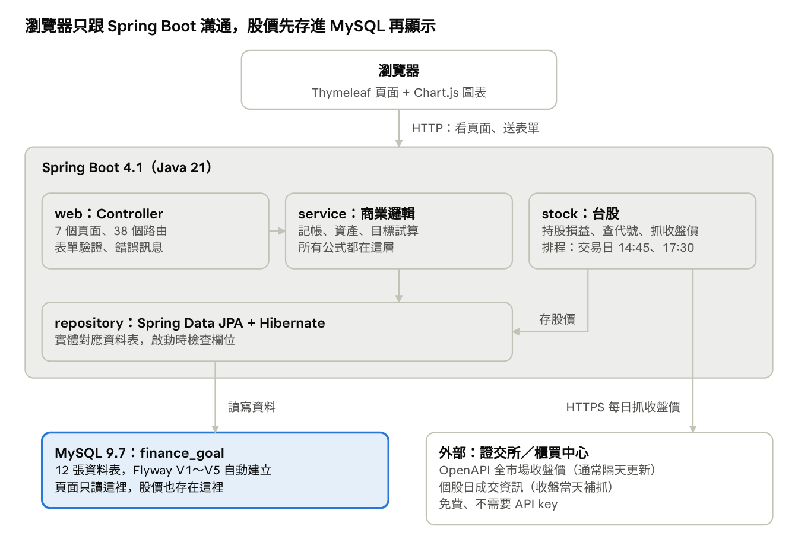

# 💰 記帳與目標系統

你現在在哪 → 想去哪 → 要花多久 → 今天該做什麼。外加「你一分鐘值多少錢」。

一個在本機執行的個人理財網站：記帳、管理資產（現金、活存、定存、台股）、設定理財目標，並把每筆花費換算成「要工作多久才賺得到」。



- **技術**：Spring Boot 4.1 · Java 21 · Thymeleaf · MySQL · Flyway · Chart.js
- **安全**：沒有登入功能，伺服器只監聽 `127.0.0.1:8081`，只有你自己的電腦連得到。

---

## 👋 rain 請看這裡

要報告「目標試算」的話，照這個順序看：

1. **[目標試算-新增目標.md](docs/目標試算-新增目標.md)**：在頁面上新增一個目標時，表單怎麼一路存進資料庫，經過哪些程式、在哪一行。附兩個 debug 練習（成功新增、故意填錯）。
2. **[目標試算-第一個1000萬.md](docs/目標試算-第一個1000萬.md)**：打開「第一個 1000 萬」時，怎麼算出「每月要存 $31,487」和六種建議，以及用 IntelliJ IDEA／VS Code 設中斷點 debug 的步驟。
3. **[匯報.md](docs/匯報.md)**：整個系統的功能、架構和計算規則，報告時可以當背景資料。
4. **[匯報簡報.pptx](docs/匯報簡報.pptx)**：8 頁簡報（封面、需求、架構、功能、目標試算、資料庫、Demo、已知限制與下一步），每頁都有講稿備註。

想在自己電腦上跑起來：照下面「🚀 如何啟動」的方法 B，再匯入[示範資料](#想直接看到示範資料選用)，就會有和截圖一樣的「第一個 1000 萬」可以 debug。

---

## 🚀 如何啟動

### 需要先安裝

| 軟體 | 版本 | 檢查指令 |
| --- | --- | --- |
| Java JDK | **21** 以上 | `java -version` |
| Git | 任意 | `git --version` |
| MySQL | 8 以上（只有「正式模式」需要） | `mysql --version` |

Maven 不用另外安裝，專案內附的 `./mvnw` 會自動下載。

### 下載專案

```bash
git clone https://github.com/HongLeongYong/finance-goal.git
cd finance-goal
```

### 方法 A：免裝 MySQL，馬上試玩（最快）

用 H2 記憶體資料庫啟動，**關掉伺服器資料就會清空**，適合先看看長什麼樣子：

```bash
./mvnw spring-boot:test-run
```

看到 `Started FinanceGoalApplication` 後，用瀏覽器打開 👉 http://127.0.0.1:8081

> Windows 請把 `./mvnw` 換成 `mvnw.cmd`。第一次執行會下載相依套件，大約需要 1～3 分鐘。

### 方法 B：接 MySQL，資料會保存（正式使用）

**1. 建立資料庫和帳號**（用 MySQL 的 root 執行一次就好）：

```bash
mysql -u root -p
```

進入 MySQL 後貼上（`你的密碼` 換成自己想設的密碼）：

```sql
CREATE DATABASE finance_goal CHARACTER SET utf8mb4 COLLATE utf8mb4_unicode_ci;
CREATE USER IF NOT EXISTS 'app_user'@'localhost' IDENTIFIED BY '你的密碼';
GRANT ALL PRIVILEGES ON finance_goal.* TO 'app_user'@'localhost';
FLUSH PRIVILEGES;
EXIT;
```

**2. 設定資料庫帳密**：複製範例設定檔，再把裡面的密碼改成上一步設定的密碼。

```bash
cp src/main/resources/application-local.properties.example src/main/resources/application-local.properties
```

`application-local.properties` 已經列在 `.gitignore`，密碼不會被 commit。也可以不建這個檔，改用環境變數 `DB_USERNAME`、`DB_PASSWORD`。

**3. 啟動**：

```bash
./mvnw spring-boot:run
```

第一次啟動時，Flyway 會自動建立所有資料表（V1～V5），不用手動跑 SQL。看到 `Started FinanceGoalApplication` 後打開 👉 http://127.0.0.1:8081

**4. 停止**：在終端機按 `Ctrl + C`。

### 想直接看到示範資料？（選用）

專案附了一份假資料 [`docs/demo-data.sql`](docs/demo-data.sql)：模擬一位 28 歲、在台北租屋的上班族，2025/11～2026/11 約 1,390 筆記帳、5 個帳戶、2 筆定存、8 個目標、3 檔台股。

先用方法 B **啟動過一次**（讓 Flyway 建好資料表），再執行：

```bash
mysql -u app_user -p finance_goal < docs/demo-data.sql
```

重新整理網頁就會看到資料。⚠️ 匯入會**先清空**現有的記帳、帳戶、目標、股票等資料，再換成示範資料，請不要匯入到你已經在用的資料庫。匯入後可以到「台股持股」按一次「🔄 立即更新股價」，抓最新收盤價。

方法 A（H2 試玩模式）不會載入示範資料，一開始是空的。

### 第一次使用建議

1. 到 **⚙️ 設定** 填月薪、上下班與午休時間，「今天已經賺了」計數器和「= 工作 xx 分鐘」才會出現。
2. 到 **🏦 資產與定存** 新增帳戶（錢包、銀行活存、信用卡）和定存。
3. 開始 **🧾 記帳**，記帳時選帳戶，餘額會自動增減。
4. 有台股的話，到 **📈 台股持股** 記買進紀錄。股價在交易日 14:45、17:30 自動更新；伺服器關著時不會更新，啟動後按一次「🔄 立即更新股價」即可。

### 常見問題

| 狀況 | 解法 |
| --- | --- |
| `Port 8081 was already in use` | 已經有一個伺服器在跑，先把它關掉；或在 `application.properties` 改 `server.port` |
| `Access denied for user 'app_user'`（1045） | `application-local.properties` 的密碼和 MySQL 設的不一樣 |
| `Access denied ... to database 'finance_goal'`（1044） | 帳號沒有授權，重新執行上面的 `GRANT` 那一行 |
| `release version 21 not supported` | Java 版本太舊，安裝 JDK 21 |
| 股價一直沒更新 | 需要連網；上櫃股票第一次查詢約 30 秒 |

---

## 🧪 測試

```bash
./mvnw test
```

36 個自動化測試，使用 H2 記憶體資料庫（MySQL 相容模式），**不需要 MySQL，也不會連網**，不會動到你的真實資料。

---

## 功能與設計

7 個頁面：儀表板、記帳、月報表、資產與定存、目標試算、台股持股、設定。

每個頁面的功能、計算公式、資料模型、股價來源與已知限制，都整理在 👉 **[docs/匯報.md](docs/匯報.md)**，這裡不重複。

## 專案結構

```
src/main/java/com/example/finance/
├── model/        資料表對應的實體（Entity）
├── repository/   Spring Data JPA
├── service/      商業邏輯與所有公式
├── stock/        台股：股價抓取、持股損益、買賣
├── form/         表單與驗證
└── web/          Controller（頁面與路由）
src/main/resources/
├── db/migration/ Flyway SQL（V1～V5）
├── templates/    Thymeleaf 頁面
└── static/       CSS、JavaScript
```
