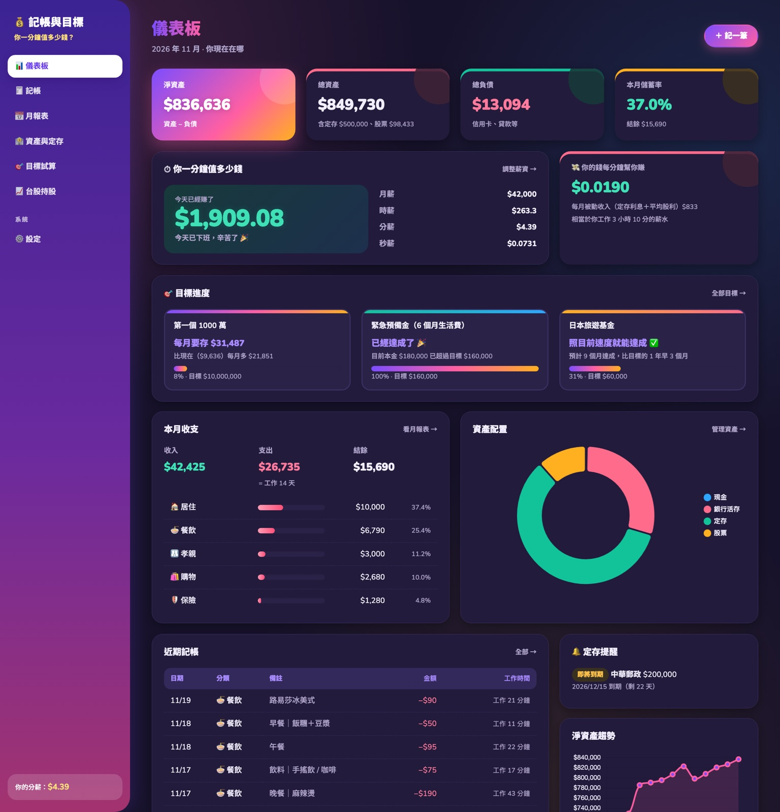
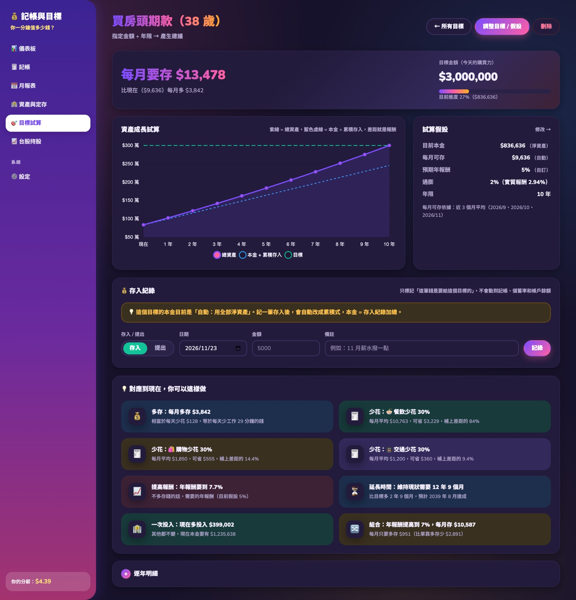
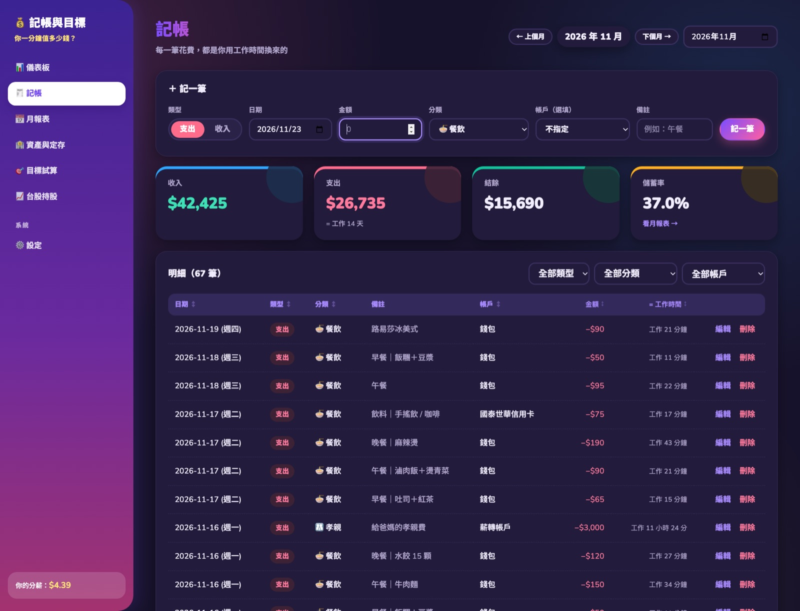
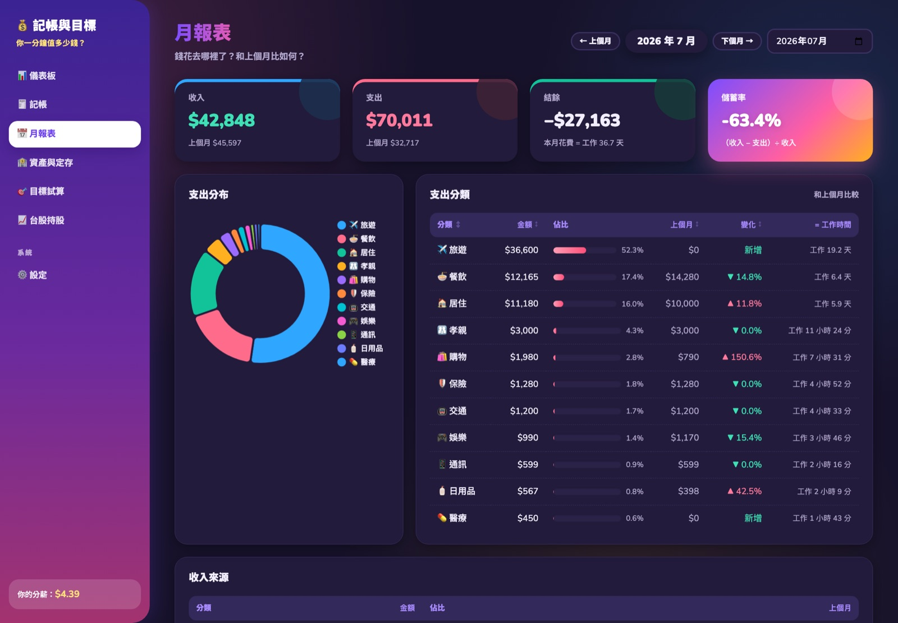
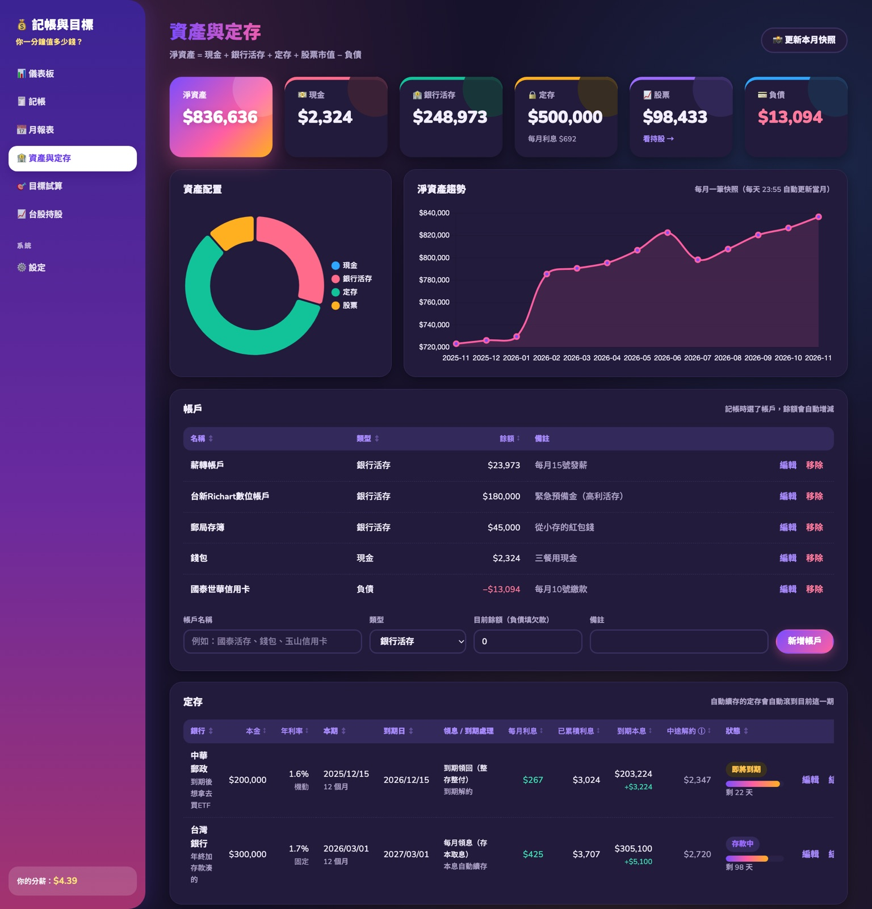
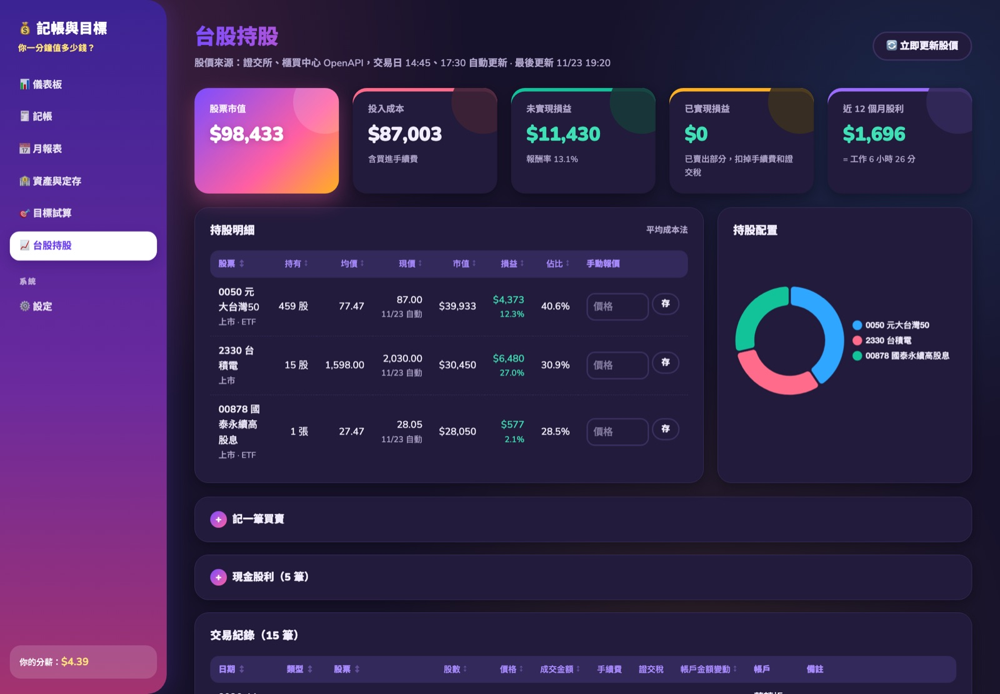
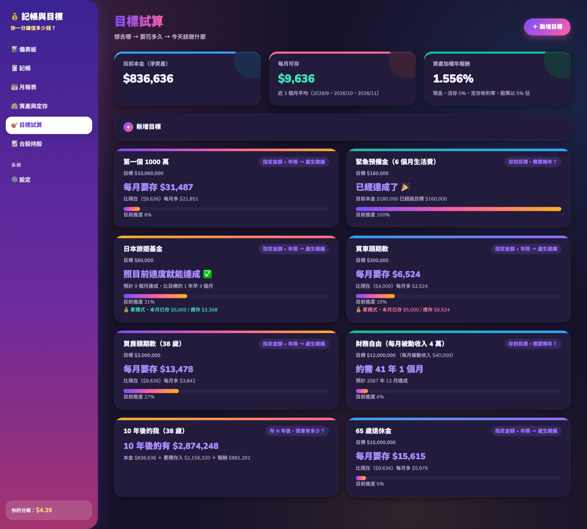
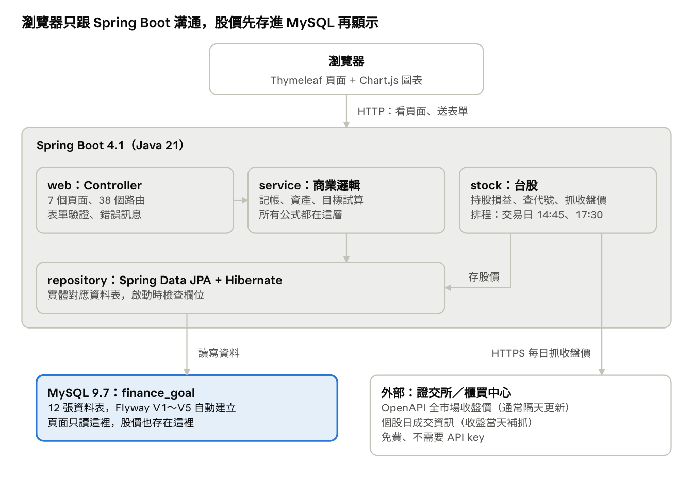

# 記帳與目標系統：專案匯報

2026-11-23 · hong leong

> 線上版（可編輯、可留言）：https://claude.ai/artifact/VTFYdg3U5K1q61wqNdshk9

一個在本機執行的個人理財網站：記帳、管理資產（含定存與台股）、設定理財目標，並把每筆花費換算成「要工作多久才賺得到」。三期開發已全部完成，36 個自動化測試通過。

原始碼：[github.com/HongLeongYong/finance-goal](https://github.com/HongLeongYong/finance-goal)（公開）。

## 畫面一覽

**儀表板**：一打開就看到淨資產、本月儲蓄率、「今天已經賺了」即時計數器，以及目標進度。



**目標試算**：輸入目標金額和年限，算出每月要存多少，並給出六種補足差距的方案。



| 記帳 | 月報表 |
| --- | --- |
|  |  |
| 每筆金額旁邊顯示「= 工作 xx 分鐘」 | 7 月去日本：儲蓄率變負、旅遊支出暴增 |

| 資產與定存 | 台股持股 |
| --- | --- |
|  |  |
| 帳戶、定存試算、淨資產一年趨勢 | 持股損益、股利、證交所自動抓收盤價 |



## 系統架構



所有請求都經過 Spring Boot；web 層只處理頁面與表單，公式集中在 service。外部股價由排程先存進 MySQL，所以證交所網站掛掉時頁面照常顯示。

## 技術框架

後端是 Spring Boot 4.1 + Java 21 的伺服器端渲染網站，沿用組內 Java_website 的架構，沒有另外的前端框架。

| 層 | 技術 | 版本 | 用途 |
| --- | --- | --- | --- |
| 語言 | Java | 21 | 全部後端程式，大量使用 record |
| 框架 | Spring Boot（Web MVC、Validation、Scheduling） | 4.1.2 | 路由、表單驗證、每日排程 |
| ORM | Spring Data JPA + Hibernate | 7.4.13 | 實體對應資料表，啟動時 `validate` 檢查欄位 |
| 資料庫 | MySQL | 9.7 | 正式資料，資料庫 `finance_goal` |
| 資料表版本 | Flyway | 12.4 | V1～V5 共 5 個 migration，啟動時自動套用 |
| 頁面 | Thymeleaf | 3.1.5 | 伺服器端產生 HTML，共 16 個樣板 |
| 前端 | 原生 CSS + JavaScript、Chart.js 4.4.1 | — | 圖表、表格排序、即時試算，無建置流程 |
| 外部 API | Spring RestClient（JDK HttpClient） | — | 抓證交所、櫃買中心股價 |
| 測試 | JUnit 5、MockMvc、AssertJ、H2（MySQL 相容模式） | H2 2.4 | 36 個測試，不需要真的 MySQL |
| 建置 | Maven Wrapper | 3.10 | `./mvnw` 一行指令建置、測試、啟動 |

程式規模：Java 71 個檔案約 4,900 行，測試 8 個檔案約 700 行，CSS／JS 約 850 行。套件依功能分成 `model`、`repository`、`service`、`stock`、`form`、`web`。

## 功能介紹

系統有 7 個頁面，回答四個問題：你現在在哪、想去哪、要花多久、今天該做什麼。

| 頁面 | 網址 | 主要功能 |
| --- | --- | --- |
| 儀表板 | `/` | 淨資產、本月儲蓄率、「今天已經賺了」即時計數器（午休暫停）、時薪／分薪／秒薪、錢每分鐘幫你賺多少、目標進度、資產配置、定存到期提醒 |
| 記帳 | `/ledger` | 一行快速記帳、輸入金額即時顯示「= 工作 xx 分鐘」、選帳戶自動增減餘額、依月份／類型／分類／帳戶篩選、可排序表格 |
| 月報表 | `/ledger/report` | 收支與儲蓄率、支出分類佔比圖、和上個月比較的漲跌 |
| 資產與定存 | `/assets` | 現金／活存／負債帳戶、定存（到期日、已累積利息、中途解約試算、自動續存）、淨資產每月趨勢 |
| 目標試算 | `/goals` | 三種模式：N 年後會有多少、需要幾年達成、指定金額＋年限產生行動建議；支援被動收入目標、通膨、累積式存入紀錄 |
| 台股持股 | `/stocks` | 輸入代號自動查名稱、手續費／證交稅自動算、平均成本法損益、現金股利（同時記成收入）、每日自動抓收盤價 |
| 設定 | `/settings` | 月薪、上下班與午休時間、券商手續費折扣、收支分類 |

設計重點：

- **你一分鐘值多少錢**：每筆花費都換算成工作時間，例如 150 元咖啡 = 工作 34 分鐘。
- **行動建議**：差距換算成多存、少花（排除房租、孝親等必要支出與一次性支出）、提高報酬、延長時間、一次投入、組合六種方案。
- **累積式目標**：存入只標記用途，不當成支出，所以不影響儲蓄率與淨資產。
- **網頁優先**：桌機寬螢幕版面，繽紛糖果色系，支援深色模式；手機只保證不跑版。

## 核心計算規則

金額一律用 BigDecimal 計算，只有目標試算的複利與二分法用 double。每條規則都有單元測試。

**分薪**：每天工時 = 下班 − 上班 − 午休。例如 08:30～17:00、午休 12:15～13:30 = 7.25 小時，月薪 42,000 → 分薪 $4.39。

```
分薪 = 月薪 ÷（每月上班天數 × 每天工時 × 60）
```

**定存**：每月領息（存本取息）是單利，到期領回（整存整付）按月複利。中途解約：未滿 1 個月不計息，滿 1 個月以上按實存月數、目前利率八折估算。

```
到期本息 = P × (1 + r/12)^n
```

**目標試算**：每月月底存入、按月複利。需要的年報酬用二分法反推；填了通膨就改用實質報酬 (1 + 名目) ÷ (1 + 通膨) − 1。被動收入目標 = 每月被動收入 × 12 ÷ 提領率。

```
FV = PV × (1+r)^n + PMT × ((1+r)^n − 1) / r
```

**台股**：

- 手續費 = 成交金額 × 0.1425% × 券商折扣，無條件捨去；整股最低 20 元（可設定），零股最低 1 元。
- 證交稅（只有賣出）：一般股票 0.3%，ETF（代號 00 開頭）0.1%。
- 損益用平均成本法：未實現 = 市值 − 持有成本；已實現 = 賣出金額 − 手續費 − 稅 − 賣掉部分的平均成本。

**淨資產** = 現金 + 活存 + 定存 + 股票市值 − 負債。每次資產變動和每天 23:55 更新當月快照。

## 資料模型

共 12 張資料表，依功能分成 5 組；另有 Flyway 自動建立的 `flyway_schema_history` 記錄資料表版本。

| 功能 | 資料表 | 存什麼 |
| --- | --- | --- |
| 個人設定 | `profile` | 月薪、上下班與午休時間、券商手續費折扣（只有一筆） |
| 記帳 | `ledger_entry` | 每筆收支：日期、金額、分類、帳戶、備註 |
| 記帳 | `category` | 收支分類與圖示，例如餐飲、居住、薪水 |
| 資產 | `account` | 現金、活存、負債帳戶與目前餘額 |
| 資產 | `time_deposit` | 定存：本金、年利率、期數、領息方式、到期處理 |
| 資產 | `net_worth_snapshot` | 每月淨資產快照，用來畫趨勢圖 |
| 目標 | `goal` | 目標金額或被動收入、計算模式、試算假設、本金來源 |
| 目標 | `goal_contribution` | 累積式目標的存入／提出紀錄 |
| 台股 | `stock` | 股票代號、名稱、上市或上櫃 |
| 台股 | `stock_trade` | 買賣紀錄：股數、價格、手續費、證交稅、交割帳戶 |
| 台股 | `stock_dividend` | 現金股利，連結到對應的記帳收入 |
| 台股 | `stock_price` | 每日收盤價（自動抓或手動輸入） |

資料表全部由 Flyway migration（V1～V5）建立，啟動時自動套用；Hibernate 只檢查、不自動改表。

幾個設計決定：

- 記帳選了帳戶，餘額會同步增減；信用卡等負債帳戶反向計算（消費讓欠款增加）。
- 定存的到期日、利息不存進資料庫，每次顯示時依今天日期即時計算，自動續存也不用排程。
- 股價存在 `stock_price`，頁面只讀資料庫；外部 API 掛掉時頁面照常顯示。

## 外部資料與排程

股價來自證交所與櫃買中心的官方公開資料，免費、不用 API key。交易日 14:45、17:30 自動更新，也可以在頁面上手動更新。

| 來源 | 用途 | 特性 |
| --- | --- | --- |
| 證交所 OpenAPI `STOCK_DAY_ALL` | 上市全部收盤價 | 約 1,400 檔、1 秒；通常晚一個交易日更新 |
| 櫃買中心 OpenAPI | 上櫃全部收盤價 | 約 1.4 萬筆、約 5MB、約 30 秒 |
| 證交所個股日成交資訊 `STOCK_DAY` | 補抓上市股票當天收盤價 | 收盤後當天就有；有頻率限制，每檔間隔 1.5 秒 |

穩定性設計：

- 外部資料一律先存進資料庫，抓不到時最壞只是價格停在上一次。
- 查代號用的清單快取 6 小時；手動輸入的價格不會被自動覆蓋。
- 每次抓到的價格都和證交所官方個股資料比對過，例如台積電 11/20 收盤 2,000。

其他排程：每天 23:55 更新當月淨資產快照。伺服器關著時排程不會執行，啟動後要手動更新一次股價。

## 品質與測試

36 個自動化測試全部通過，執行 `./mvnw test` 約 1 分鐘，不需要 MySQL 也不連網。

| 測試類別 | 數量 | 涵蓋內容 |
| --- | --- | --- |
| 整合測試（MockMvc） | 17 | 每一頁能開、記帳增減餘額、編輯刪除還原、三種目標模式、累積式目標、台股買賣與股利、表單驗證 |
| 單元測試 | 19 | 分薪、定存試算、目標公式、手續費與證交稅、平均成本、證交所資料解析、一次性支出判斷 |

做法：

- 測試用 H2 記憶體資料庫（MySQL 相容模式），跑同一套 Flyway migration，確保資料表和正式環境一致。
- 股價來源有介面 `QuoteSource`，測試換成假資料，不連網。
- 「今天」一律由注入的 `Clock`（台北時區）提供，方便測試。
- 建立在本機的預覽模式 `./mvnw spring-boot:test-run`，免裝 MySQL 就能試玩。

## Demo 流程

建議照「你現在在哪 → 想去哪 → 今天該做什麼」的順序展示，約 10 分鐘。

1. **儀表板**：先讓大家看「今天已經賺了」計數器在跳，說明分薪怎麼算、午休會暫停。
2. **記帳**：現場記一筆 150 元咖啡，看金額旁邊即時顯示「= 工作 34 分鐘」、錢包餘額自動減少。
3. **月報表**：切到 7 月（日本旅遊那個月），儲蓄率變負、旅遊分類暴增。
4. **資產與定存**：淨資產趨勢圖、定存即將到期提醒、中途解約試算。
5. **台股**：按「立即更新股價」，對照證交所官網的收盤價；輸入 0050 示範自動查名稱與手續費試算。
6. **目標試算**：打開「買房頭期款」看六種行動建議；再打開「日本旅遊基金」，現場記一筆存入。
7. **技術面**：快速帶過架構圖、Flyway migration 與 `./mvnw test` 跑完 36 個測試。

事前準備：匯報前啟動伺服器並按一次更新股價；確認可連網（字型與股價需要）。

## 已知限制與風險

| 項目 | 影響 | 目前做法 |
| --- | --- | --- |
| 沒有登入功能 | 只能本機一人使用 | 伺服器只監聽 127.0.0.1 |
| 沒有「轉帳」 | 提款、繳信用卡、存進另一個帳戶記不進去 | 直接改帳戶餘額 |
| 固定收支要手動記 | 房租、交通費每月都要自己輸入 | 待做 |
| 上櫃股票沒有當天補抓 | 上櫃股價晚一個交易日 | 可手動輸入價格 |
| 配股、除權息不會自動記錄 | 股利要手動輸入 | FinMind 需申請 token，未接 |
| 多個目標不互相扣除 | 自動模式的目標都用全部淨資產當起點 | 專款目標用累積式或手動本金 |
| 伺服器關著時排程不執行 | 股價與快照會缺幾天 | 啟動後手動更新 |
| 示範資料是假的 | 過去的買進價、每月快照是編的，只有現價是真的 | 匯報時說明 |

## 下一步

建議依順序進行，可在匯報時請組員投票排優先順序。

- [ ] 「轉帳」功能：提款、繳信用卡、帳戶間搬錢，不算收支
- [ ] 「固定收支」：房租、交通費、訂閱每月自動產生
- [ ] 目標綁定專用帳戶（做法 B），花費時可選「從哪個目標基金支出」
- [ ] 上櫃股票當天收盤價補抓、自動記錄除權息
- [ ] 預算上限與超支提醒、匯入銀行／信用卡 CSV
- [ ] 要給多人用的話：加上登入（Spring Security）與部署

## 如何啟動

安裝、接 MySQL、常見問題的完整步驟寫在 [GitHub README](https://github.com/HongLeongYong/finance-goal#-如何啟動)。最快的試玩方式是 clone 後執行 `./mvnw spring-boot:test-run`（不用裝 MySQL），再打開 http://127.0.0.1:8081。
