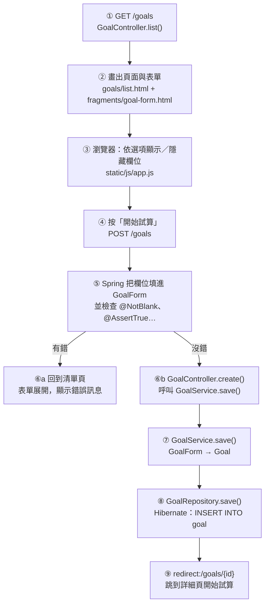

# 目標試算：新增一個目標會經過哪些程式

這份文件說明在「目標試算」頁新增一個目標（例如再建一個和「第一個 1000 萬」一樣的目標）時，資料從表單一路走到資料庫，經過哪些程式、各自在哪一行，以及每一步怎麼 debug。

新增完成後會自動跳到目標的詳細頁，那一段（怎麼算出每月要存多少）請看 [目標試算-第一個1000萬.md](目標試算-第一個1000萬.md)。

> 行號以 `main` 分支的 commit `b55c1ad` 為準。路徑都從 `src/main/` 開始。

---

## 1. 範例：再建一個「第一個 1000 萬」

在 http://127.0.0.1:8081/goals 按「＋ 新增目標」，填：

| 欄位 | 填什麼 | 送出時的欄位名稱 |
| --- | --- | --- |
| 目標名稱 | 第二個 1000 萬 | `name` |
| 目標內容 | 存到一筆金額 | `targetType=AMOUNT` |
| 目標金額 | 10000000 | `targetAmount` |
| 想算什麼 | 指定金額 + 年限 → 產生建議 | `mode=PLAN` |
| 年數 | 20 | `years` |
| 目前本金從哪裡來 | 自動：用全部淨資產 | `principalMode=AUTO` |
| 每月可存、年報酬、通膨 | 空白（自動帶入） | `monthlySavingOverride` 等，空白會送出空值 |

按「開始試算」。

---

## 2. 整體流程



---

## 3. 每一步的程式位置

### ① 打開目標清單頁

| 檔案:行號 | 做什麼 |
| --- | --- |
| `java/com/example/finance/web/GoalController.java:42` | `list()`：準備一個空的 `GoalForm`，再試算所有現有目標 |
| `java/com/example/finance/form/GoalForm.java:14` | `GoalForm` 的預設值：模式 `PLAN`、提領率 4%、本金來源 `AUTO` |

### ② 畫出表單

| 檔案:行號 | 做什麼 |
| --- | --- |
| `resources/templates/goals/list.html:11` | 「＋ 新增目標」按鈕：展開下方的表單 |
| `resources/templates/goals/list.html:24-27` | 收合的表單區塊，載入共用的表單片段 |
| `resources/templates/fragments/goal-form.html:5` | 表單本體：`method="post"`、送到 `/goals`；每個 `th:field` 對應 `GoalForm` 的一個欄位 |

### ③ 瀏覽器端：依選項顯示欄位（JavaScript）

| 檔案:行號 | 做什麼 |
| --- | --- |
| `resources/static/js/app.js:60-67` | 選「存到一筆金額」才顯示「目標金額」；選「指定年限」才顯示「年數」；選「手動輸入」才顯示「本金」 |

這段只影響畫面，不影響後端檢查。

### ④～⑤ 送出表單、綁定資料、檢查

Spring 依欄位名稱（`name`、`targetAmount`…）呼叫 `GoalForm` 的 setter 填入資料，再依註解檢查：

| 檔案:行號 | 檢查什麼 | 錯誤訊息 |
| --- | --- | --- |
| `GoalForm.java:16` | `@NotBlank`：名稱不能空白 | 請幫目標取個名字 |
| `GoalForm.java:58` | `isTargetAmountPresent()`：金額型目標要填金額 | 請填目標金額 |
| `GoalForm.java:63` | `isPrincipalPresent()`：選手動本金就要填金額 | 選了「手動輸入」就要填本金 |
| `GoalForm.java:68` | `isPassiveIncomePresent()`：被動收入型要填每月金額 | 請填每月想要的被動收入 |
| `GoalForm.java:73` | `isYearsValid()`：指定年限、N 年後模式要填 1～60 年 | 這個模式要填年數 |

`@AssertTrue` 標在 `isXxx()` 方法上：方法回傳 `false` 就算錯，錯誤訊息會顯示在對應欄位下方（`goal-form.html` 裡的 `th:errors`）。

### ⑥ Controller 決定下一步

| 檔案:行號 | 做什麼 |
| --- | --- |
| `GoalController.java:52` | `create()` 的入口；`@Valid` 代表進來之前已經檢查完，結果在 `BindingResult result` |
| `GoalController.java:54-59` | **有錯**：重新試算清單、`openForm = true` 讓表單保持展開，回到 `goals/list` 顯示錯誤 |
| `GoalController.java:60` | **沒錯**：呼叫 `goalService.save(null, form)`，`null` 代表新增，不是修改 |
| `GoalController.java:61-62` | 放一則「已新增目標」訊息，轉址到 `/goals/{新的 id}` |

### ⑦ Service：把表單資料轉成實體

| 檔案:行號 | 做什麼 |
| --- | --- |
| `java/com/example/finance/service/GoalService.java:75` | `@Transactional`：整個儲存在同一個交易裡，出錯就全部還原 |
| `GoalService.java:77` | `id == null` → 建立 `new Goal()`；有 id 則讀出既有目標來修改（編輯目標也走這裡） |
| `GoalService.java:78-89` | 一個一個欄位從 `GoalForm` 複製到 `Goal`；名稱會去掉前後空白 |
| `GoalService.java:86` | 本金只有在「手動輸入」時才保留，其他模式一律存成空值 |
| `GoalService.java:90` | 交給 Repository 存檔 |

### ⑧ Repository：寫進資料庫

| 檔案:行號 | 做什麼 |
| --- | --- |
| `java/com/example/finance/repository/GoalRepository.java:7` | 繼承 `JpaRepository`，`save()` 是 Spring Data 內建的，不用自己寫 |
| `java/com/example/finance/model/Goal.java:17-21` | `@Entity` 對應 `goal` 表；`@GeneratedValue(IDENTITY)` 由 MySQL 自動產生 id |
| `Goal.java:70` | `createdAt` 在 `new Goal()` 時自動填入現在時間 |
| `resources/db/migration/V3__goals.sql` | `goal` 表的欄位定義（V5 加了 `principal_mode`） |

Hibernate 實際執行的 SQL 大致是：

```sql
INSERT INTO goal (name, target_type, target_amount, mode, years, principal_mode, withdrawal_rate, created_at, ...)
VALUES ('第二個 1000 萬', 'AMOUNT', 10000000, 'PLAN', 20, 'AUTO', 4, NOW(), ...);
```

### ⑨ 跳到詳細頁

瀏覽器收到轉址後打開 `/goals/{id}`，接著的試算流程請看 [目標試算-第一個1000萬.md](目標試算-第一個1000萬.md)。

---

## 4. 怎麼 debug

開發工具的設定（IntelliJ IDEA、VS Code 怎麼用 Debug 模式啟動）請看 [目標試算-第一個1000萬.md 的第 5 節](目標試算-第一個1000萬.md#5-可以-debug-嗎可以)。記得先停掉正在跑的伺服器，避免 8081 被佔用。

### 建議的中斷點

| 想看什麼 | 中斷點 | 停下來時看哪些變數 |
| --- | --- | --- |
| 表單送進來的資料 | `GoalController.java:54`（`if (result.hasErrors())`） | `form`（展開看每個欄位）、`result`（有哪些錯誤） |
| 某個檢查為什麼失敗 | `GoalForm.java:73`（`isYearsValid()`） | `mode`、`years` |
| 表單怎麼轉成實體 | `GoalService.java:77` | 按 F8 一行一行走，看 `g` 的欄位被填入 |
| 存檔後拿到的 id | `GoalService.java:90` | 按 F8 後看回傳的 `Goal`，`id` 已經有值 |
| 轉址到哪 | `GoalController.java:62` | `id` |

### 練習 1：走一次成功的新增

1. 在 `GoalController.java:54` 和 `GoalService.java:77` 設中斷點，用 Debug 模式啟動。
2. 照第 1 節填表、按「開始試算」，程式停在 `GoalController.java:54`。
3. 在 Debugger 面板展開 `form`：`name = "第二個 1000 萬"`、`targetAmount = 10000000`、`mode = PLAN`、`years = 20`。
4. 展開 `result`：`errorCount = 0`。
5. 按 F9 繼續，停在 `GoalService.java:77`；按 F8 一路走到第 90 行，觀察 `g` 的欄位一個一個被填入。
6. 再按 F8，回傳的 `Goal` 有了新的 `id`。

### 練習 2：故意填錯，看檢查怎麼擋下來

1. 在 `GoalForm.java:73`（`isYearsValid()`）設中斷點。
2. 選「指定金額 + 年限」，**年數留空**，按「開始試算」。
3. 程式停在 `isYearsValid()`：`mode = PLAN`、`years = null`，所以會走到第 77 行並回傳 `false`。
4. 按 F9 繼續，`GoalController.java:54` 的 `result.hasErrors()` 是 `true`，回到清單頁並在年數下方顯示「這個模式要填年數」。
5. 資料庫裡**不會**多一筆目標，因為根本沒有走到 `save()`。

### 看實際執行的 SQL

在 `src/main/resources/application-local.properties`（不會進 git）加上：

```properties
spring.jpa.show-sql=true
spring.jpa.properties.hibernate.format_sql=true
```

重新啟動後，新增目標時終端機會印出 `insert into goal (...) values (?, ?, ...)`。

也可以直接查資料庫，確認最新一筆：

```sql
SELECT id, name, target_amount, mode, years, principal_mode, created_at
FROM goal ORDER BY id DESC LIMIT 1;
```

### 看瀏覽器送了什麼

Chrome 按 F12 打開開發者工具 → **Network** 分頁 → 按「開始試算」→ 點 `goals` 那一筆 → **Payload**，可以看到每個欄位名稱和值，例如 `name: 第二個 1000 萬`、`mode: PLAN`、`years: 20`。

前端的顯示／隱藏欄位要 debug 的話：開發者工具 → **Sources** → 找到 `js/app.js` 第 60 行附近設中斷點，切換「目標內容」或「想算什麼」就會停下來。

### 對應的自動化測試

不開網站也能驗證新增流程，測試在 `src/test/java/com/example/finance/WebFlowTests.java`：

| 測試 | 行號 | 驗證什麼 |
| --- | --- | --- |
| `goalsInAllThreeModes()` | 154 | 三種模式各新增一個目標，詳細頁都能正常打開 |
| `planModeRequiresYears()` | 193 | 指定年限模式沒填年數會被擋下，資料庫不會多一筆 |
| `manualPrincipalRequiresAmount()` | 235 | 選手動本金卻沒填金額會被擋下 |

```bash
./mvnw test -Dtest=WebFlowTests
```

在 IDE 裡點測試方法旁的 ▶ 選 **Debug**，上面的中斷點一樣會停下來，而且用的是測試專用的 H2 資料庫，不會在你的 MySQL 裡多出測試資料。
