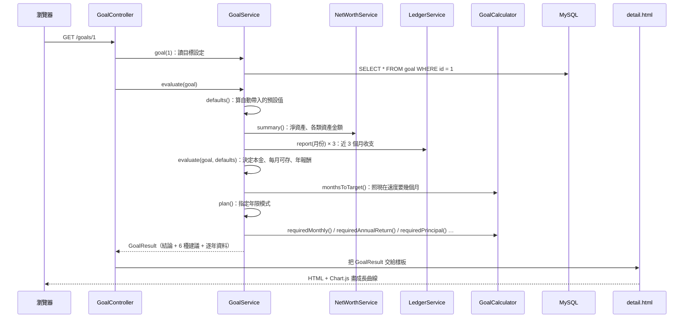

# 目標試算：「第一個 1000 萬」的實現方式與程式位置

這份文件說明一個目標從「資料庫裡的一筆設定」變成「網頁上的每月要存 $31,487 和六種建議」，中間經過哪些程式、各自在哪一行，以及怎麼用 debug 一步一步看它算。

> 文中的數字是 2026-11-24 用示範資料試算的結果；記帳或股價一變，數字就會跟著變。
> 行號以 `main` 分支的 commit `586e02c` 為準。

---

## 1. 這個目標在做什麼

**網址**：http://127.0.0.1:8081/goals/1

| 設定 | 值 | 說明 |
| --- | --- | --- |
| 目標內容 | 存到一筆金額：$10,000,000 | |
| 計算模式 | 指定金額 + 年限 → 產生建議（`PLAN`） | 三種模式之一 |
| 年限 | 20 年 | |
| 本金來源 | 自動（`AUTO`）：用全部淨資產 | 目前 $836,636 |
| 每月可存 | 自動：近 3 個月平均結餘 | 目前 $9,636 |
| 預期年報酬 | 自動：資產依金額加權 | 目前 1.556% |
| 通膨 | 不考慮 | |

**畫面上算出來的結果**

| 項目 | 值 |
| --- | --- |
| 結論 | **每月要存 $31,487**，比現在多 $21,851 |
| 💰 多存 | 每月多存 $21,851 = 每天少花 $728 = 每天少工作 2 小時 46 分的錢 |
| 🧾 少花 | 餐飲 −30% 省 $3,229、購物 −30% 省 $555、交通 −30% 省 $360 |
| 📈 提高報酬 | 年報酬要到 8.1% |
| ⏳ 延長時間 | 維持現狀需要 48 年（2074 年 11 月） |
| 🏦 一次投入 | 現在多投入 $4,504,223 |
| 🔀 組合 | 年報酬 3.6% ＋ 每月存 $23,775 |

---

## 2. 一個請求的旅程

打開 `/goals/1` 時，程式的呼叫順序：



---

## 3. 程式在哪裡

路徑都從 `src/main/` 開始。

### 後端（Java）

| 步驟 | 檔案:行號 | 做什麼 |
| --- | --- | --- |
| 收到請求 | `java/com/example/finance/web/GoalController.java:65` | `detail()`：讀目標、呼叫 `evaluate()`、交給樣板 |
| 目標設定 | `java/com/example/finance/model/Goal.java` | 對應 `goal` 資料表的欄位 |
| 目標金額 | `java/com/example/finance/model/Goal.java:77` | `resolvedTargetAmount()`：金額型直接回傳；被動收入型換算成金額 |
| 試算入口 | `java/com/example/finance/service/GoalService.java:351` | `evaluate(Goal g)`：先算預設值，再試算 |
| 自動預設值 | `java/com/example/finance/service/GoalService.java:225` | `defaults()`：本金、每月可存、年報酬、各分類平均支出 |
| 　└ 淨資產 | `java/com/example/finance/service/NetWorthService.java:83` | `summary()`：現金 + 活存 + 定存 + 股票 − 負債 |
| 　└ 每月可存 | `GoalService.java:234-248` | 近 3 個月有記帳的月份，平均（收入 − 支出） |
| 　└ 年報酬 | `GoalService.java:258-265` | 股票 × 5% + 定存 × 各自利率，除以總資產 |
| 決定假設 | `GoalService.java:361-402` | `evaluate(g, d)`：本金來源（自動／手動／累積式）、每月可存、年報酬 |
| 轉成計算用的數字 | `GoalService.java:404-408` | `pv` 本金、`pmt` 每月可存、`rate` 年報酬、`fvTarget` 目標 |
| 照現在速度要多久 | `GoalService.java:412` | `monthsToTarget()` |
| 依模式分流 | `GoalService.java:416-420` | 「第一個 1000 萬」是 `PLAN`，進 `plan()` |
| **指定年限模式** | `GoalService.java:464` | `plan()`：本功能的核心 |
| 　└ 每月要存 | `GoalService.java:469` | `requiredMonthly()` → $31,487 |
| 　└ 能不能達成 | `GoalService.java:470` | `futureValue() >= 目標` → false |
| 　└ 💰 多存 | `GoalService.java:483-490` | 差額 ÷ 30 天，再換算成工作時間 |
| 　└ 🧾 少花 | `GoalService.java:493-503` | 排除必要支出與一次性支出，取前 3 大分類 × 30% |
| 　└ 📈 提高報酬 | `GoalService.java:506-516` | `requiredAnnualReturn()`，超過 10% 加風險提醒 |
| 　└ ⏳ 延長時間 | `GoalService.java:519-526` | 用第 412 行算好的月數 |
| 　└ 🏦 一次投入 | `GoalService.java:529-531` | `requiredPrincipal()` − 目前本金 |
| 　└ 🔀 組合 | `GoalService.java:534-541` | 年報酬 + 2 個百分點後，重算每月要存 |
| 回傳結果 | `GoalService.java:543-544` | `GoalResult`，附 20 年的逐年資料給圖表用 |
| 可調參數 | `GoalService.java:37-44` | 必要支出清單、少花比例 30%、組合加 2%、股票預期 5% |

### 數學公式（純計算，不碰資料庫）

`java/com/example/finance/service/GoalCalculator.java`

| 方法 | 行號 | 公式 |
| --- | --- | --- |
| `realRate()` | 28 | 實質報酬 = (1 + 名目) ÷ (1 + 通膨) − 1 |
| `futureValue()` | 45 | FV = PV × (1+r)^n + PMT × ((1+r)^n − 1) / r |
| `monthsToTarget()` | 50 | 用對數反推 n；100 年內達不到回傳 `null` |
| `requiredMonthly()` | 77 | PMT = (FV − PV × (1+r)^n) ÷ ((1+r)^n − 1) / r |
| `requiredPrincipal()` | 83 | PV = (FV − PMT × 年金因子) ÷ (1+r)^n |
| `requiredAnnualReturn()` | 88 | 二分法：在 −50%～100% 之間找讓 FV = 目標的年報酬 |
| `yearlySeries()` | 115 | 逐年總資產與「本金 + 累積存入」，給圖表用 |

其中 r = 年報酬 ÷ 12（月利率），n = 年數 × 12（月數）。

### 前端（畫面）

| 部分 | 檔案:行號 |
| --- | --- |
| 結論「每月要存 $31,487」 | `resources/templates/goals/detail.html:23` |
| 成長曲線的畫布 | `resources/templates/goals/detail.html:40` |
| 六種建議卡片 | `resources/templates/goals/detail.html:152` |
| 把逐年資料交給圖表 | `resources/templates/goals/detail.html:184` |
| 畫成長曲線（Chart.js） | `resources/static/js/app.js:225`，`projection()` |

### 資料存在哪

| 資料表 | 建立它的 migration | 內容 |
| --- | --- | --- |
| `goal` | `resources/db/migration/V3__goals.sql`、`V5__goal_contributions.sql` | 目標金額、模式、年限、各項覆寫值 |

試算結果**不存進資料庫**，每次打開頁面都用最新的記帳和資產重新計算。

---

## 4. 用實際數字走一遍

| 變數 | 值 | 從哪裡來 |
| --- | --- | --- |
| `pv` 本金 | 836,636 | `NetWorthService.summary()` 的淨資產 |
| `pmt` 每月可存 | 9,636 | 2026/9、10、11 三個月平均結餘 |
| `rate` 年報酬 | 0.01556 | (股票 98,433 × 5% + 定存 30 萬 × 1.7% + 定存 20 萬 × 1.6%) ÷ 總資產 |
| `months` | 240 | 20 年 × 12 |
| `fvTarget` | 10,000,000 | `goal.target_amount` |

1. **照現在速度**：`futureValue(836,636, 9,636, 1.556%, 240)` 約 $385 萬，遠低於 1,000 萬，所以 `onTrack = false`。
2. **每月要存**：`requiredMonthly(836,636, 1.556%, 240, 10,000,000)` = **$31,487**。
3. **差額**：31,487 − 9,636 = $21,851，再 ÷ 30 ≈ 每天 $728。
4. **其他建議**：用同一組數字代入第 3 節的其他公式。

---

## 5. 可以 debug 嗎？可以

這是標準的 Spring Boot 專案，任何支援 Java 的編輯器都能設中斷點，一行一行看變數的值。

> ⚠️ 用 debug 模式啟動前，先停掉已經在跑的伺服器（終端機按 `Ctrl + C`），不然 8081 會被佔用。

### 方法 1：IntelliJ IDEA（最推薦，Community 版免費）

1. IntelliJ → **Open** → 選 `finance_goal` 資料夾，等右下角 Maven 匯入完成。
2. 打開 `src/main/java/com/example/finance/FinanceGoalApplication.java`。
3. 在 `GoalService.java` **第 469 行**（`double required = …`）左邊的行號旁點一下，出現紅點就是中斷點。
4. 回到 `FinanceGoalApplication.java`，點 `main` 旁邊的綠色箭頭 → **Debug 'FinanceGoalApplication'**（蟲子圖示）。
5. 瀏覽器打開 http://127.0.0.1:8081/goals/1，程式會停在第 469 行。
6. 下方 **Debugger** 面板可以看到 `pv`、`pmt`、`rate`、`fvTarget` 的值：
   - **F8**（Step Over）：執行這一行，看 `required` 變成多少。
   - **F7**（Step Into）：進到 `GoalCalculator.requiredMonthly()` 看公式怎麼算。
   - **F9**（Resume）：繼續跑到下一個中斷點。

### 方法 2：VS Code

1. 安裝擴充套件 **Extension Pack for Java** 和 **Spring Boot Extension Pack**。
2. 打開 `finance_goal` 資料夾，在 `GoalService.java:469` 設中斷點。
3. 左側 **Run and Debug** → 選 `FinanceGoalApplication` → 開始 debug。
4. 瀏覽器打開 `/goals/1`。快捷鍵：F10 執行下一行、F11 進入方法、F5 繼續。

### 方法 3：終端機啟動，再用編輯器連上去

適合習慣用 `./mvnw` 啟動的人：

```bash
./mvnw spring-boot:run -Dspring-boot.run.jvmArguments="-agentlib:jdwp=transport=dt_socket,server=y,suspend=n,address=127.0.0.1:5005"
```

看到 `Listening for transport dt_socket at address: 5005` 後，在 IntelliJ 新增 **Remote JVM Debug**（port 5005）或在 VS Code 選 **Attach**，就能連上去設中斷點。`127.0.0.1` 表示只有本機能連，比較安全。

### 方法 4：只 debug 公式（最快，不用開網站）

公式在 `GoalCalculator`，有現成的單元測試 `src/test/java/com/example/finance/GoalCalculatorTests.java`：

```bash
./mvnw test -Dtest=GoalCalculatorTests
```

在 IntelliJ 或 VS Code 打開這個測試檔，點測試方法旁的 ▶ 選 **Debug**，就能在公式裡設中斷點。例如 `planTenMillionInTenYears()` 驗證的就是「每月要存」的公式。

### 推薦的中斷點

| 想看什麼 | 設在哪裡 |
| --- | --- |
| 本金、每月可存、年報酬怎麼來的 | `GoalService.java:404`（`double pv = …`） |
| 每月要存多少 | `GoalService.java:469` |
| 能不能照目前速度達成 | `GoalService.java:470` |
| 哪些分類被建議「少花」 | `GoalService.java:498`（`for` 迴圈） |
| 自動年報酬怎麼加權 | `GoalService.java:264` |
| 公式本身 | `GoalCalculator.java:77`、`88` |

### 小技巧

- **只停在這個目標**：目標清單頁和儀表板會一次試算全部 8 個目標，中斷點會停很多次。在中斷點上按右鍵設**條件** `g.getId() == 1`，就只會在「第一個 1000 萬」停下來。
- **改完程式自動重啟**：專案有 Spring DevTools，存檔重新編譯後網站會自動重啟，debug 連線可能會中斷一下，重新整理頁面即可。

### 小實驗：改一個參數看看

把 `GoalService.java:38` 的 `CUT_RATIO = 0.3` 改成 `0.5`，重新整理 `/goals/1`：「少花」建議的標題會變成「少花 50%」，可省金額也跟著變大。

標題的百分比是用 `pct(CUT_RATIO)` 算出來的（`GoalService.java:500`），所以只要改一個參數，文字和金額會一起變。早期版本這裡是寫死的「少花 30%」，改參數時標題不會跟著變，後來已修正。
